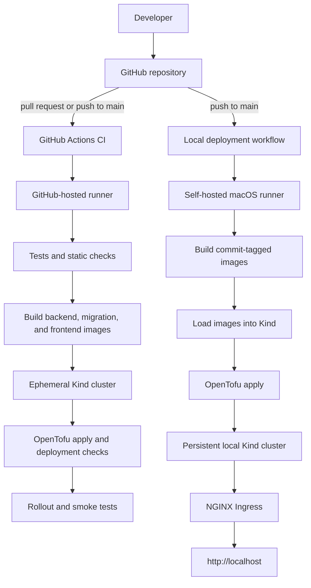
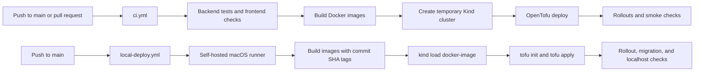
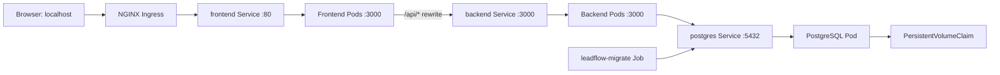

# LeadFlow


**LeadFlow** is a lightweight lead-management application and a production-inspired DevOps portfolio project. It brings a Next.js web UI, an Express API, and PostgreSQL together in a containerized, Kubernetes-deployed stack.

The project demonstrates the path from application source to a running cluster: Docker images, declarative Kubernetes infrastructure managed by OpenTofu, database migrations, automated checks, and deployments through GitHub Actions.

> The deployment target is a local [Kind](https://kind.sigs.k8s.io/) cluster. OpenTofu manages resources **inside** that cluster; it does not provision a cloud account or Kubernetes cluster.

## Architecture



### Application components

| Component | Responsibility |
|---|---|
| **Next.js frontend** | Renders the lead-management interface and proxies `/api` requests to the backend. |
| **Express API** | Provides lead, discussion, statistics, and operational endpoints. |
| **PostgreSQL** | Stores leads, discussions, and migration history. |
| **Migration Job** | Runs the backend's compiled migration program as a separate Kubernetes Job before the API rollout. |
| **OpenTofu** | Defines and reconciles the Kubernetes resources with the HashiCorp Kubernetes provider. |
| **Kind** | Runs the Kubernetes cluster locally or in the disposable CI validation job. |
| **NGINX Ingress** | Routes HTTP traffic from the local host to the frontend Service. The controller is bootstrapped separately from the application resources. |

### CI/CD flow



The workflows are separate. CI validates the change in an ephemeral environment; the local deployment workflow targets the developer's persistent Kind cluster on pushes to `main`.

### Kubernetes request path



## Features

- Lead list and detail views with status filtering, search, discussion history, and follow-up reminders.
- Dashboard statistics for lead volume, conversions, and follow-ups.
- Multi-stage Docker builds for the frontend and backend; the migration workload uses the backend image.
- PostgreSQL with an idempotent, ordered SQL migration runner.
- Kubernetes Namespace, ConfigMaps, Secret, PVC, Deployments, Services, Job, and Ingress.
- Startup, liveness, and readiness probes; resource requests and limits; non-root application containers.
- OpenTofu modules for declarative Kubernetes resource management and ordered application rollouts.
- GitHub Actions validation, image builds, ephemeral Kind deployment checks, and a self-hosted local deployment workflow.
- Kubernetes Deployment revision history and manual rollout rollback commands.
- Ingress smoke checks that verify the app at `http://localhost`.

## Repository structure

```text
.
├── backend/
│   ├── migrations/             # Versioned SQL migrations
│   ├── src/                    # Express API, database access, migration and seed code
│   ├── test/                   # Backend integration tests
│   ├── Dockerfile
│   └── package.json
├── frontend/
│   ├── app/                    # Next.js App Router pages and styles
│   ├── components/             # Lead UI components
│   ├── lib/                    # Shared TypeScript types
│   ├── Dockerfile
│   └── package.json
├── k8s/                        # Original Kubernetes YAML reference implementation
├── terraform/
│   ├── environments/local/     # Kind provider configuration and module wiring
│   └── modules/                # Namespace, data, app, migration, and networking resources
├── .github/workflows/
│   ├── ci.yml                  # Hosted CI and ephemeral Kind validation
│   └── local-deploy.yml        # Self-hosted deployment to local Kind
├── scripts/create-kind.sh      # Creates Kind and bootstraps the NGINX controller
├── docker-compose.yml          # Local multi-container development stack
├── kind-config.yml             # Kind node labels and localhost port mappings
├── k8s.md                      # Kubernetes reference documentation
├── terraform.md                # Infrastructure design notes
└── README.md
```

The typed OpenTofu modules are the deployment source of truth. The `k8s/` directory is retained as the original/reference implementation; avoid applying those manifests alongside OpenTofu-managed resources.

## Tech stack

| Area | Technology |
|---|---|
| Language | TypeScript, SQL |
| Frontend | Next.js 16, React, Tailwind CSS |
| Backend | Node.js 22, Express |
| Database | PostgreSQL 16 |
| Containerization | Docker, Docker Compose |
| Cloud native | Kubernetes, Kind, NGINX Ingress |
| Infrastructure as Code | OpenTofu, HashiCorp Kubernetes provider |
| CI/CD | GitHub Actions, self-hosted macOS runner |

## Prerequisites

For application development:

- Git
- Node.js 22 recommended (the backend declares Node.js 20 or newer) and npm
- Docker Desktop for the Compose database or full-stack run

For Kubernetes deployment:

- Docker Desktop with its engine running
- Kind and `kubectl`
- OpenTofu 1.5 or newer
- A macOS GitHub self-hosted runner for `local-deploy.yml`

The local deployment workflow expects the runner to have `docker`, `kind`, `kubectl`, `tofu`, and `curl` available on its `PATH`. Configure the runner with the `self-hosted` and `macOS` labels.

## Local development

### Run the full stack with Docker Compose

From the repository root:

```bash
docker compose up --build
```

Compose starts PostgreSQL, waits for its health check, runs the migration service, and then starts the API and frontend. Open **<http://localhost:3000>**. The frontend proxies API requests to the `backend` service over the Compose network.

Stop the stack with:

```bash
docker compose down
```

The named PostgreSQL volume is preserved. To remove the database volume as well, use `docker compose down --volumes`; this deletes local database data.

### Run the applications directly

The backend needs a PostgreSQL database and exports its settings through environment variables. `backend/.env.example` is a development example; the API process does not load it automatically.

```bash
# Start only the Compose database
docker compose up -d database

# Backend terminal
cd backend
npm ci
cp .env.example .env
set -a
source .env
set +a
npm run migrate
npm run seed       # Optional sample data; resets the lead/discussion tables
npm run dev        # API on http://localhost:3001 with the example settings
```

In another terminal:

```bash
cd frontend
npm ci
cp .env.example .env
npm run dev        # UI on http://localhost:3000
```

The frontend's development rewrite uses `DEV_API_URL` from its example environment. For production builds, `API_INTERNAL_URL` is supplied as a Docker build argument.

### Common application commands

| Directory | Command | Purpose |
|---|---|---|
| `backend/` | `npm test` | Run API integration tests; they require a disposable PostgreSQL database and clear the test tables. |
| `backend/` | `npm run lint` | Type-check the TypeScript backend. |
| `backend/` | `npm run build` | Compile the backend into `dist/`. |
| `backend/` | `npm start` | Start the compiled API. |
| `backend/` | `npm run migrate` / `npm run migrate:prod` | Run migrations from source / compiled output. |
| `frontend/` | `npm run lint` | Run ESLint. |
| `frontend/` | `npm run build` | Build the standalone Next.js app. |

## Infrastructure deployment

OpenTofu provisions resources **inside** Kind. It does not create the Kind cluster or install Docker Desktop. The local environment uses the `kind-leadflow` kubeconfig context by default.

To bootstrap a new local cluster, run:

```bash
bash scripts/create-kind.sh
kubectl config current-context
```

The script creates a `leadflow` Kind cluster using `kind-config.yml`, maps host ports 80 and 443, installs the official Kind-specific NGINX Ingress manifest, and waits for the controller. The `local-deploy.yml` workflow reuses an existing cluster and invokes the script only when the cluster is absent.

Set the required database values through protected environment variables. Use values appropriate for your local database; do not commit real credentials.

```bash
export TF_VAR_postgres_user='<database-user>'
export TF_VAR_postgres_password='<database-password>'
export TF_VAR_database_url='postgres://<database-user>:<database-password>@postgres:5432/leadflow'
```

Then initialize and review the plan:

```bash
cd terraform
tofu fmt -recursive
cd environments/local
tofu init
tofu validate
tofu plan
tofu apply
tofu output
```

OpenTofu composes reusable modules and manages the namespace, database Secret, ConfigMaps, PostgreSQL PVC/Deployment/Service, migration Job, backend and frontend Deployments/Services, and application Ingress. The PostgreSQL claim deliberately does not wait for `Bound`: Kind's `WaitForFirstConsumer` storage class requires a scheduled pod to bind it.

The PostgreSQL workload is a single replica with a `ReadWriteOnce` volume. It is suitable for this local project, not a highly available production database. Review plans carefully, and back up data before any operation that could replace or delete the PVC.

## Kubernetes design

| Resource | Role |
|---|---|
| `leadflow` Namespace | Scopes application resources. |
| PostgreSQL Deployment, Service, and PVC | Runs one database pod and preserves its data across pod replacement. |
| Migration Job | Runs `node dist/migrate.js`; the migration runner tracks applied SQL files in `schema_migrations`. |
| Backend Deployment and Service | Runs two API replicas behind the internal `backend:3000` Service. |
| Frontend Deployment and Service | Runs two Next.js replicas; the Service exposes port 80 to the Ingress and targets port 3000. |
| ConfigMaps and Secret | Separate non-sensitive runtime configuration from database credentials. |
| Ingress | Routes `/` to the frontend Service using the `nginx` class. |

The API exposes `/healthz` for liveness, `/readyz` for database-aware readiness, and `/version` for the running application version. PostgreSQL uses `pg_isready`; the frontend probes `/`. Readiness gates Service traffic, while startup and liveness probes detect slow or unhealthy processes.

Frontend and backend Deployments use rolling updates with `maxUnavailable: 0`, `maxSurge: 1`, readiness probes, and a bounded revision history. This is designed to reduce application downtime during updates; it cannot guarantee zero downtime if new pods fail readiness, the cluster lacks capacity, or a database change is incompatible. PostgreSQL uses a single-replica `Recreate` strategy.

## CI/CD

### Hosted CI — `.github/workflows/ci.yml`

The CI workflow runs on pushes to `main` and pull requests targeting `main`.

1. Starts an isolated PostgreSQL service for backend integration tests.
2. Installs npm dependencies and runs backend tests and TypeScript checks.
3. Runs frontend lint checks.
4. Builds backend and migration images from the backend Dockerfile, and builds the frontend image.
5. Creates a disposable Kind cluster, installs the Kind ingress controller, loads the images, and runs OpenTofu validation and apply.
6. Waits for workload rollouts and migration completion, then checks Kubernetes resources, backend health, and Ingress reachability.

The CI deployment is a short-lived validation environment; it does not publish images to a registry.

### Local continuous deployment — `.github/workflows/local-deploy.yml`

The local deployment workflow runs on pushes to `main` on a self-hosted macOS runner. It checks the required tools and Docker Desktop, reuses the `leadflow` Kind cluster or bootstraps it with `scripts/create-kind.sh`, and ensures ingress-nginx is available.

It builds commit-tagged backend, migration, and frontend images on the runner, loads them into Kind, runs `tofu init` and `tofu apply -auto-approve`, then waits for PostgreSQL, migration, backend, and frontend readiness. It verifies Service endpoints, checks the API health endpoint, and makes an HTTP request through Ingress at **<http://localhost>**.

The workflows are triggered independently by GitHub events; the local deployment workflow is not configured as a downstream job of the hosted CI workflow.

## Secrets management

No live credentials should be committed to Git. The repository provides example configuration for local development and OpenTofu:

- `backend/.env.example` and `frontend/.env.example` document local application settings.
- `terraform/environments/local/terraform.tfvars.example` contains non-secret infrastructure defaults.
- The Kubernetes Secret example uses replacement placeholders and is not a production credential source.
- The local deployment workflow reads database credentials from GitHub Secrets: `LEADFLOW_POSTGRES_USER`, `LEADFLOW_POSTGRES_PASSWORD`, and `LEADFLOW_DATABASE_URL`.

OpenTofu marks sensitive variables to reduce accidental CLI disclosure, but Kubernetes Secret data can still be present in OpenTofu state. Protect state files and runner access. Kubernetes Secrets are not, by themselves, an encrypted secret manager. Use unique credentials outside disposable local/test environments.

## Rollback

Kubernetes retains recent Deployment revisions, so a failed application rollout can be inspected and manually rolled back:

```bash
kubectl rollout history deployment/backend -n leadflow
kubectl rollout undo deployment/backend -n leadflow
kubectl rollout status deployment/backend -n leadflow
```

Use the corresponding `frontend` Deployment commands when needed. This is a Kubernetes capability, not a dedicated automated rollback workflow. Because OpenTofu is the desired-state owner, a manual `kubectl rollout undo` can create drift; for a durable rollback, revert the release/image change in Git and let the deployment workflow reconcile it. Database migrations must remain compatible with both the current and previous application versions.

## Challenges and solutions

| Challenge | Problem and root cause | Resolution | Lesson |
|---|---|---|---|
| Migration Job failures | The Job could not complete when the database endpoint, credentials, or image was unavailable. | Verify `DATABASE_URL`, load the migration image into Kind, and gate the backend rollout on Job completion. | Check database reachability and image availability before diagnosing migration SQL. |
| `ImagePullBackOff` | Kind's container runtime does not automatically see images built in the host Docker daemon. | Use `kind load docker-image` for the exact tags referenced by Deployments and Jobs. | A local image must be transferred into each newly created Kind cluster. |
| OpenTofu state drift | Kubernetes objects existed but were not represented correctly in OpenTofu state. | Synchronize resource ownership with the configured OpenTofu state and avoid managing the same objects through competing tools. | State is part of IaC; inspect plans and preserve state when changing runners or environments. |
| PVC binding wait | The storage class uses `WaitForFirstConsumer`, so the PVC cannot bind until a pod is scheduled. | Configure the provider not to block on PVC binding; let the PostgreSQL Deployment trigger provisioning. | Understand provider waits and Kubernetes reconciliation timing, not just resource order. |
| Self-hosted runner queue | Local deployment jobs remain queued if no eligible runner is online or labels do not match. | Register and keep the macOS runner online with the required labels, tools, and Docker Desktop access. | Runner health, labels, and machine-local dependencies are part of the deployment system. |
| Ingress returned HTTP 404 | An Ingress object alone does not route traffic; controller readiness and backend endpoints also matter. | Verify the ingress-nginx controller, rollout readiness, service endpoints, and route before smoke testing. | Test the full request path rather than only checking that an Ingress resource exists. |
| Credential handling | Database credentials are required by PostgreSQL, the API, and migrations. | Pass them through GitHub Secrets and Kubernetes Secrets; keep example files as templates. | Protect both the secret source and any state that may contain secret values. |
| Rollout timing | Kubernetes accepts desired state before the workloads are necessarily ready. | Wait for Deployment rollout and migration completion with explicit timeouts before HTTP smoke tests. | API acceptance is not the same as application readiness. |

## Screenshots

No project screenshots are included yet. Add captures to `docs/screenshots/` as the portfolio is updated.

| View | Screenshot placeholder |
|---|---|
| Architecture diagram | `docs/screenshots/architecture.png` |
| GitHub Actions CI success | `docs/screenshots/ci-success.png` |
| Self-hosted runner deployment | `docs/screenshots/local-deployment.png` |
| OpenTofu apply | `docs/screenshots/opentofu-apply.png` |
| Kubernetes resources (`kubectl get all`) | `docs/screenshots/kubernetes-resources.png` |
| Application running at localhost | `docs/screenshots/application.png` |
| Rollback demonstration | `docs/screenshots/rollback.png` |

## Future improvements

- Add a remote, encrypted OpenTofu state backend with locking and recovery procedures.
- Publish immutable images to GHCR instead of rebuilding separately for local deployment.
- Introduce Blue/Green or canary releases with explicit traffic switching.
- Add Prometheus metrics, Grafana dashboards, and alerting.
- Configure TLS with cert-manager and a real hostname.
- Evaluate a Horizontal Pod Autoscaler for stateless application workloads.
- Adopt GitOps with Argo CD if pull-based continuous reconciliation becomes a project goal.
- Add tested PostgreSQL backup and restore, and a managed or highly available database design before production use.

## Key learnings

- **Infrastructure as Code:** state, provider configuration, dependency graphs, and explicit ownership are critical to safe reconciliation.
- **Kubernetes:** readiness, probes, Services, storage binding, and rollout strategy all affect whether an application is actually available.
- **Docker and Kind:** local images must be loaded into Kind, and tags must match the workload specification.
- **Migrations:** schema changes need a separately observable Job and a success gate before application rollout.
- **CI/CD:** hosted validation and local deployment have different runner and cluster lifecycles; separating them makes those responsibilities visible.
- **Secrets:** credentials must be protected across GitHub, Kubernetes, and OpenTofu state—not just omitted from source files.
- **Rollbacks:** application revisions are useful, but database compatibility and declarative desired state determine whether a rollback is safe and durable.

## Conclusion

LeadFlow demonstrates a complete, production-inspired workflow for containerizing a full-stack application, validating it in CI, and deploying it to a local Kubernetes cluster with OpenTofu and GitHub Actions. It brings together Docker, Kind, PostgreSQL, Kubernetes health checks, migration gating, ingress routing, and a self-hosted deployment runner.

The project is intentionally local and educational rather than a claim of production-grade high availability. Its modular infrastructure and automated checks provide a foundation for future improvements such as remote state, registry publishing, observability, TLS, and progressive delivery.
